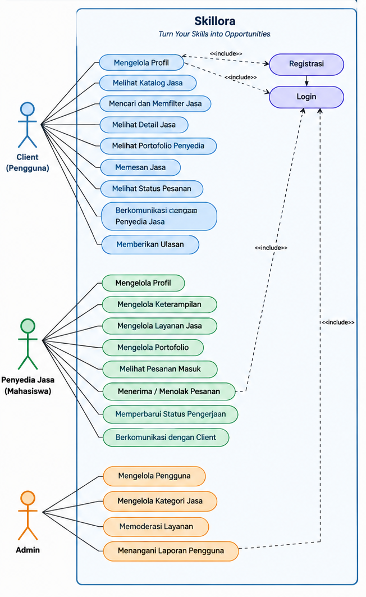
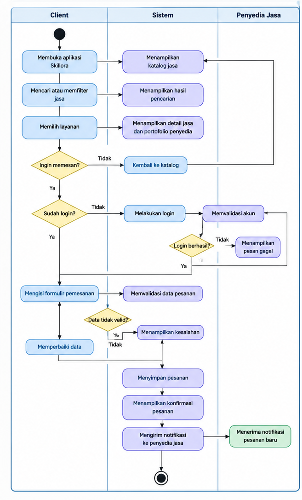
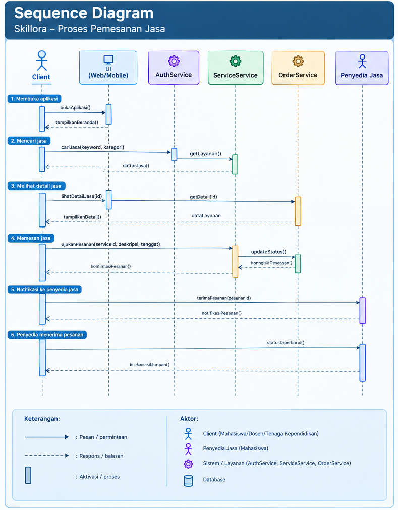
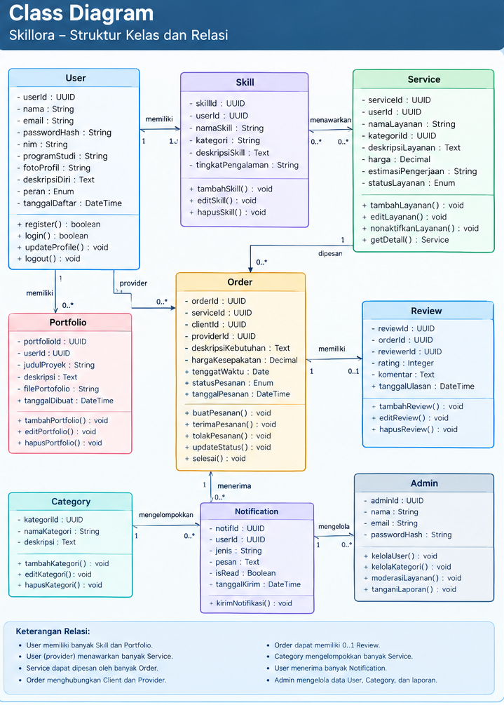

# SOFTWARE REQUAREMENTS SPECIFICATION (SRS)
## Skillora: Student Skill Marketplace

**Tagline:** *Turn Your Skills into Opportunities.*

**Mata Kuliah:** Workshop Pengembangan Perangkat Lunak  
**Nama Produk:** Skillora  
**Jenis Produk:** Marketplace Jasa Berbasis Keterampilan Mahasiswa  
**Target Pengguna:** Mahasiswa dan civitas akademika  
**Ruang Lingkup:** Lingkungan kampus  
**Versi Dokumen:** 1.0

---

# 1. ANALISIS SISTEM

## 1.1. Gambaran Umum Sistem

Skillora merupakan platform marketplace yang dirancang untuk menghubungkan mahasiswa yang memiliki keterampilan tertentu dengan pengguna yang membutuhkan jasa tersebut di lingkungan kampus. Platform ini memungkinkan mahasiswa mempromosikan keahliannya, menampilkan portofolio, menentukan harga jasa, serta menerima permintaan pekerjaan dari pengguna.

Pengembangan Skillora dilatarbelakangi oleh adanya mahasiswa yang memiliki keterampilan di bidang teknologi informasi, pemrograman, desain grafis, multimedia, pemasaran digital, dan bidang lainnya, tetapi belum memiliki wadah yang sesuai untuk menawarkan keterampilan mereka kepada calon pengguna jasa.

Selain itu, mahasiswa yang baru memulai karier sebagai penyedia jasa sering menghadapi kesulitan dalam memperoleh klien melalui marketplace freelance berskala luas karena persaingan dengan penyedia jasa lain, keterbatasan portofolio, dan belum adanya reputasi yang terbentuk.

Oleh karena itu, Skillora difokuskan pada lingkungan kampus sebagai pasar awal yang lebih terarah. Dengan adanya platform ini, mahasiswa diharapkan dapat menemukan peluang pekerjaan, membangun portofolio, memperoleh pengalaman profesional, dan mengembangkan keterampilan melalui proyek nyata.

## 1.2. Identifikasi Masalah

Berdasarkan konsep awal produk dan daftar keterampilan mahasiswa yang telah dikumpulkan, permasalahan yang menjadi dasar pengembangan Skillora adalah sebagai berikut.

1. Mahasiswa yang memiliki keterampilan belum tentu mengetahui tempat yang tepat untuk menawarkan jasa mereka.
2. Mahasiswa pemula dapat mengalami kesulitan mendapatkan klien melalui marketplace freelance umum karena tingginya persaingan.
3. Mahasiswa belum tentu memiliki portofolio atau reputasi yang cukup untuk menarik perhatian calon pengguna jasa.
4. Pengguna di lingkungan kampus dapat mengalami kesulitan menemukan mahasiswa dengan keterampilan yang sesuai dengan kebutuhan mereka.
5. Informasi mengenai keterampilan, harga jasa, hasil pekerjaan, dan ketersediaan penyedia jasa belum terhimpun dalam satu platform khusus.
6. Belum tersedia mekanisme terpusat yang secara khusus mempertemukan kebutuhan jasa di lingkungan kampus dengan keterampilan mahasiswa.

Permasalahan tersebut merupakan hipotesis awal yang perlu divalidasi melalui wawancara dengan calon pengguna dan calon penyedia jasa.

## 1.3. Tujuan Pengembangan Sistem

Tujuan pengembangan Skillora adalah:

1. Menyediakan wadah digital bagi mahasiswa untuk menawarkan jasa berdasarkan keterampilan yang dimiliki.
2. Mempermudah pengguna menemukan penyedia jasa dari kalangan mahasiswa sesuai kebutuhan.
3. Membantu mahasiswa memperoleh peluang proyek dan pengalaman kerja.
4. Menyediakan fitur profil, portofolio, pencarian jasa, dan pemesanan.
5. Membangun ekosistem layanan berbasis keterampilan yang mendukung kolaborasi di lingkungan kampus.

## 1.4. Target Pengguna

| No. | Jenis Pengguna | Deskripsi | Kebutuhan Utama |
|---|---|---|---|
| 1 | Mahasiswa penyedia jasa | Mahasiswa yang memiliki keterampilan dan ingin menawarkan jasa. | Mempromosikan jasa, memperoleh klien, dan membangun portofolio. |
| 2 | Mahasiswa pengguna jasa | Mahasiswa yang membutuhkan bantuan atau layanan tertentu. | Menemukan jasa, melihat portofolio, dan melakukan pemesanan. |
| 3 | Dosen dan tenaga kependidikan | Civitas akademika yang membutuhkan layanan sesuai ruang lingkup aplikasi. | Menemukan mahasiswa yang kompeten untuk kebutuhan proyek atau pekerjaan tertentu. |
| 4 | Administrator | Pengelola platform yang bertanggung jawab terhadap pengelolaan sistem. | Mengelola akun, memoderasi layanan, dan menangani laporan pengguna. |

**Batasan ruang lingkup:** Pada tahap awal, Skillora ditujukan untuk kebutuhan di lingkungan kampus. Pengguna dari luar kampus belum menjadi target utama pengembangan.

---

# 2. KEBUTUHAN FUNGSIONAL

Kebutuhan fungsional menjelaskan fitur dan proses yang harus dapat dilakukan oleh sistem Skillora.

| ID | Nama Fitur | Deskripsi Kebutuhan Fungsional | Prioritas |
|---|---|---|---|
| FR-01 | Registrasi Pengguna | Sistem menyediakan fitur pendaftaran akun menggunakan informasi identitas dan kontak pengguna. | Tinggi |
| FR-02 | Login dan Logout | Sistem memungkinkan pengguna masuk dan keluar dari akun. | Tinggi |
| FR-03 | Manajemen Profil | Pengguna dapat mengelola nama, program studi, deskripsi diri, dan informasi profil lainnya. | Tinggi |
| FR-04 | Profil Penyedia Jasa | Sistem memungkinkan mahasiswa menampilkan keterampilan, pengalaman, dan informasi layanan yang ditawarkan. | Tinggi |
| FR-05 | Katalog Jasa | Sistem menampilkan daftar jasa yang ditawarkan oleh mahasiswa. | Tinggi |
| FR-06 | Kategori Jasa | Sistem mengelompokkan layanan berdasarkan kategori, seperti pemrograman, desain, multimedia, pemasaran digital, dan kategori lainnya. | Tinggi |
| FR-07 | Pencarian Jasa | Pengguna dapat mencari jasa berdasarkan nama layanan, keterampilan, atau kata kunci. | Tinggi |
| FR-08 | Filter dan Pengurutan | Pengguna dapat menyaring atau mengurutkan jasa berdasarkan kategori, harga, dan penilaian jika tersedia. | Sedang |
| FR-09 | Detail Jasa | Sistem menampilkan deskripsi, harga, estimasi pengerjaan, portofolio, dan informasi penyedia jasa. | Tinggi |
| FR-10 | Portofolio | Penyedia jasa dapat menampilkan contoh hasil pekerjaan untuk membantu calon klien menilai kemampuannya. | Tinggi |
| FR-11 | Pengajuan Pesanan | Pengguna dapat mengajukan pesanan dengan menjelaskan kebutuhan pekerjaan dan tenggat waktu. | Tinggi |
| FR-12 | Pengelolaan Pesanan | Penyedia jasa dapat menerima atau menolak permintaan pesanan. | Tinggi |
| FR-13 | Status Pesanan | Sistem menampilkan status pesanan, seperti menunggu konfirmasi, diterima, dikerjakan, selesai, dan dibatalkan. | Tinggi |
| FR-14 | Komunikasi Pengguna | Sistem menyediakan sarana komunikasi antara pengguna dan penyedia jasa untuk membahas kebutuhan pekerjaan. | Sedang |
| FR-15 | Ulasan dan Penilaian | Pengguna dapat memberikan ulasan dan penilaian setelah pesanan diselesaikan. | Sedang |
| FR-16 | Riwayat Transaksi | Sistem menyimpan dan menampilkan riwayat pesanan pengguna dan penyedia jasa. | Sedang |
| FR-17 | Notifikasi | Sistem memberikan pemberitahuan mengenai pesanan baru dan perubahan status pesanan. | Sedang |
| FR-18 | Pengelolaan Layanan | Penyedia jasa dapat menambahkan, mengubah, dan menonaktifkan layanan yang ditawarkan. | Tinggi |
| FR-19 | Pelaporan Pengguna | Pengguna dapat melaporkan layanan atau akun yang dianggap melanggar aturan platform. | Sedang |
| FR-20 | Administrasi Sistem | Administrator dapat mengelola pengguna, kategori jasa, dan laporan yang masuk. | Tinggi |

### Catatan Pengembangan

Fitur di atas merupakan rancangan awal, bukan seluruh fitur yang wajib masuk ke versi pertama aplikasi.

Untuk MVP (*Minimum Viable Product*), fitur yang diprioritaskan adalah registrasi, login, profil mahasiswa, katalog jasa, pencarian jasa, detail jasa, portofolio, dan pemesanan.

Fitur komunikasi langsung, notifikasi lanjutan, ulasan, dan pembayaran terintegrasi dapat ditentukan setelah kebutuhan pengguna dikonfirmasi.

---

# 3. KEBUTUHAN NONFUNGSIONAL

Kebutuhan nonfungsional menjelaskan standar kualitas yang harus dipenuhi oleh aplikasi Skillora.

| ID | Aspek | Kebutuhan Nonfungsional |
|---|---|---|
| NFR-01 | Kemudahan Penggunaan | Antarmuka harus mudah dipahami oleh mahasiswa dan civitas akademika, termasuk pengguna baru. |
| NFR-02 | Responsivitas | Tampilan aplikasi harus dapat menyesuaikan ukuran layar komputer, tablet, dan ponsel. |
| NFR-03 | Kinerja | Halaman utama, katalog jasa, dan detail layanan harus dapat dimuat dengan waktu respons yang wajar pada kondisi jaringan normal. |
| NFR-04 | Keamanan | Sistem harus menerapkan autentikasi dan kontrol akses sesuai peran pengguna. |
| NFR-05 | Privasi | Informasi pribadi pengguna harus dilindungi dan hanya ditampilkan sesuai kebutuhan layanan. |
| NFR-06 | Integritas Data | Sistem harus menjaga konsistensi informasi akun, layanan, dan pesanan. |
| NFR-07 | Keandalan | Sistem harus dapat menangani proses utama tanpa kehilangan atau perubahan data yang tidak sah. |
| NFR-08 | Kompatibilitas | Aplikasi berbasis web harus dapat digunakan melalui peramban modern. |
| NFR-09 | Pemeliharaan | Kode program harus disusun secara terstruktur agar mudah diperbaiki dan dikembangkan. |
| NFR-10 | Skalabilitas | Arsitektur sistem harus memungkinkan penambahan pengguna, kategori, dan layanan pada masa mendatang. |
| NFR-11 | Aksesibilitas | Informasi dan navigasi harus mudah dibaca serta digunakan oleh pengguna dengan kebutuhan yang beragam. |
| NFR-12 | Pencadangan Data | Sistem harus memiliki mekanisme pencadangan dan pemulihan data sesuai kemampuan infrastruktur yang digunakan. |

### Kriteria Penerimaan Awal

Untuk membantu pengujian, beberapa kebutuhan nonfungsional dapat diterjemahkan menjadi kriteria yang terukur.

| ID | Kriteria Penerimaan |
|---|---|
| NFR-01 | Pengguna dapat menemukan katalog jasa dan membuka detail layanan melalui navigasi yang jelas. |
| NFR-02 | Komponen utama aplikasi tetap dapat digunakan pada ukuran layar ponsel dan komputer. |
| NFR-03 | Pada lingkungan pengujian dan jaringan normal, halaman utama ditargetkan tampil dalam waktu maksimal 3 detik. |
| NFR-04 | Pengguna yang belum login tidak dapat mengakses fungsi yang memerlukan autentikasi. |
| NFR-05 | Kata sandi tidak disimpan sebagai teks biasa, dan data pribadi tidak ditampilkan tanpa kebutuhan yang sah. |
| NFR-06 | Pesanan yang dibuat harus memiliki hubungan yang benar dengan pengguna dan layanan terkait. |

Target waktu respons merupakan sasaran awal pengembangan dan perlu diuji pada lingkungan yang ditetapkan oleh tim.

---

# 4. KEBUTUHAN DATA

Kebutuhan data menjelaskan informasi yang perlu disimpan dan dikelola oleh sistem untuk menjalankan fungsi Skillora.

## 4.1. Data Pengguna

| No. | Nama Data | Tipe Data | Keterangan |
|---|---|---|---|
| 1 | user_id | UUID/Integer | Identitas unik pengguna. |
| 2 | nama | String | Nama pengguna. |
| 3 | email | String | Alamat email pengguna. |
| 4 | password_hash | String | Representasi hash kata sandi yang dikelola secara aman. |
| 5 | nim | String, opsional | Nomor induk mahasiswa untuk kebutuhan verifikasi mahasiswa. |
| 6 | program_studi | String | Program studi pengguna. |
| 7 | foto_profil | String/URL | Lokasi foto profil jika tersedia. |
| 8 | deskripsi_diri | Text | Informasi singkat mengenai pengguna. |
| 9 | peran | Enum | Peran pengguna dalam sistem. |
| 10 | tanggal_daftar | DateTime | Waktu pembuatan akun. |

## 4.2. Data Keterampilan

| No. | Nama Data | Tipe Data | Keterangan |
|---|---|---|---|
| 1 | skill_id | UUID/Integer | Identitas keterampilan. |
| 2 | user_id | UUID/Integer | Identitas pemilik keterampilan. |
| 3 | nama_skill | String | Nama keterampilan yang dimiliki. |
| 4 | kategori | String | Kategori keterampilan. |
| 5 | deskripsi_skill | Text | Penjelasan mengenai keterampilan. |
| 6 | tingkat_pengalaman | String | Tingkat pengalaman yang dinyatakan oleh pengguna. |

## 4.3. Data Layanan Jasa

| No. | Nama Data | Tipe Data | Keterangan |
|---|---|---|---|
| 1 | service_id | UUID/Integer | Identitas layanan jasa. |
| 2 | user_id | UUID/Integer | Identitas penyedia jasa. |
| 3 | nama_layanan | String | Nama layanan yang ditawarkan. |
| 4 | kategori_id | UUID/Integer | Kategori layanan. |
| 5 | deskripsi_layanan | Text | Penjelasan tentang layanan. |
| 6 | harga | Decimal | Harga layanan. |
| 7 | estimasi_pengerjaan | String/Integer | Perkiraan durasi pengerjaan. |
| 8 | status_layanan | Enum | Status layanan, misalnya aktif atau tidak aktif. |

## 4.4. Data Portofolio

| No. | Nama Data | Tipe Data | Keterangan |
|---|---|---|---|
| 1 | portfolio_id | UUID/Integer | Identitas portofolio. |
| 2 | user_id | UUID/Integer | Identitas pemilik portofolio. |
| 3 | judul_proyek | String | Nama proyek atau hasil karya. |
| 4 | deskripsi | Text | Penjelasan mengenai hasil karya. |
| 5 | file_portofolio | String/URL | Lokasi gambar, dokumen, atau tautan proyek. |
| 6 | tanggal_dibuat | DateTime | Waktu penambahan portofolio. |

## 4.5. Data Pesanan

| No. | Nama Data | Tipe Data | Keterangan |
|---|---|---|---|
| 1 | order_id | UUID/Integer | Identitas pesanan. |
| 2 | service_id | UUID/Integer | Layanan yang dipesan. |
| 3 | client_id | UUID/Integer | Identitas pengguna yang memesan. |
| 4 | provider_id | UUID/Integer | Identitas mahasiswa penyedia jasa. |
| 5 | deskripsi_kebutuhan | Text | Penjelasan kebutuhan pekerjaan. |
| 6 | harga_kesepakatan | Decimal | Harga yang disepakati oleh kedua pihak. |
| 7 | tenggat_waktu | Date | Target penyelesaian pekerjaan. |
| 8 | status_pesanan | Enum | Status proses pesanan. |
| 9 | tanggal_pesanan | DateTime | Waktu pengajuan pesanan. |

## 4.6. Data Ulasan

| No. | Nama Data | Tipe Data | Keterangan |
|---|---|---|---|
| 1 | review_id | UUID/Integer | Identitas ulasan. |
| 2 | order_id | UUID/Integer | Identitas pesanan yang telah selesai. |
| 3 | reviewer_id | UUID/Integer | Identitas pengguna yang memberikan ulasan. |
| 4 | rating | Integer | Nilai penilaian, misalnya 1–5. |
| 5 | komentar | Text | Ulasan terhadap layanan. |
| 6 | tanggal_ulasan | DateTime | Waktu pemberian ulasan. |

## 4.7. Hubungan Antardata

Hubungan utama dalam rancangan basis data Skillora adalah sebagai berikut.

1. Satu pengguna dapat memiliki beberapa keterampilan.
2. Satu pengguna dapat menawarkan beberapa layanan.
3. Satu pengguna dapat memiliki beberapa portofolio.
4. Satu layanan dapat menerima beberapa pesanan pada waktu yang berbeda.
5. Satu pesanan menghubungkan pengguna pemesan dengan penyedia jasa.
6. Satu pesanan yang telah selesai dapat memiliki ulasan sesuai aturan sistem.

**Catatan:** Tabel kebutuhan data ini merupakan rancangan awal. Struktur tabel, tipe data, dan relasi final perlu disesuaikan dengan teknologi basis data yang dipilih tim.

---

# 5. WAWANCARA/INFORMASI DARI KLIEN

## 5.1. Identifikasi Calon Narasumber

Pengumpulan informasi awal dilakukan dengan mengidentifikasi mahasiswa yang memiliki keterampilan dan berpotensi menjadi penyedia jasa di Skillora.

Daftar yang tersedia memuat sepuluh mahasiswa dengan keterampilan yang beragam, mulai dari pengembangan perangkat lunak, desain grafis, multimedia, pemasaran digital, hingga administrasi sistem.

Data ini menjadi dasar untuk menyusun pertanyaan wawancara yang bertujuan mengetahui permasalahan, pengalaman memperoleh klien, kebutuhan fitur, dan harapan calon pengguna terhadap Skillora.

**Penting:** Karena jawaban wawancara langsung belum tersedia, tabel berikut adalah simulasi awal kebutuhan calon pengguna. Pernyataan pada kolom permasalahan dan kebutuhan fitur merupakan hipotesis untuk divalidasi, bukan kutipan atau hasil wawancara yang sudah dilakukan.

## 5.2. Tabel Analisis Kebutuhan Calon Narasumber

### Narasumber 1: Ibra Khalid Londang

**Keterampilan:** Affiliate Marketing, Programming, Marketing, Management.

| Aspek | Hasil Analisis Awal |
|---|---|
| Permasalahan yang perlu digali | Memiliki beberapa keterampilan di bidang teknologi dan pemasaran, tetapi mungkin belum memiliki satu platform yang dapat digunakan untuk menawarkan berbagai jenis jasa. |
| Hipotesis pernyataan narasumber | "Saya memiliki beberapa keterampilan yang bisa digunakan untuk membantu orang lain, tetapi saya membutuhkan tempat untuk menampilkan layanan tersebut agar lebih mudah ditemukan calon klien." |
| Fitur yang mungkin dibutuhkan | Profil penyedia jasa, kategori layanan, katalog jasa, portofolio, dan fitur penentuan harga. |
| Tujuan penggunaan Skillora | Memperkenalkan keterampilan yang dimiliki dan memperoleh peluang proyek dari lingkungan kampus. |
| Pertanyaan validasi | Apakah kamu ingin menawarkan semua keterampilan dalam satu akun? Fitur apa yang paling membantu kamu mendapatkan klien? |

### Narasumber 2: Muhammad Raihan

**Keterampilan:** Belum dicantumkan.

| Aspek | Hasil Analisis Awal |
|---|---|
| Permasalahan yang perlu digali | Jenis keterampilan, pengalaman menawarkan jasa, dan kendala memperoleh klien belum diketahui. |
| Hipotesis pernyataan narasumber | "Saya membutuhkan informasi dan sarana yang jelas untuk mengetahui bagaimana keterampilan yang saya miliki dapat ditawarkan sebagai jasa." |
| Fitur yang mungkin dibutuhkan | Pendaftaran penyedia jasa, panduan membuat profil, formulir penambahan keterampilan, dan panduan membuat layanan. |
| Tujuan penggunaan Skillora | Mengetahui cara memanfaatkan keterampilan yang dimiliki melalui platform. |
| Pertanyaan validasi | Apa keterampilan yang kamu miliki? Apakah pernah menawarkan jasa kepada orang lain? Fitur apa yang kamu harapkan dari marketplace mahasiswa? |

**Catatan:** Karena keterampilan Muhammad Raihan belum dicantumkan, kebutuhan pada tabel ini masih bersifat umum dan perlu dikonfirmasi melalui wawancara.

### Narasumber 3: Abadan Syakira

**Keterampilan:** Pembuatan Website, Video Editing, Videography, Graphic Design.

| Aspek | Hasil Analisis Awal |
|---|---|
| Permasalahan yang perlu digali | Memiliki keterampilan di bidang pengembangan website dan multimedia, tetapi mungkin membutuhkan media yang efektif untuk menampilkan berbagai hasil karya. |
| Hipotesis pernyataan narasumber | "Saya ingin menawarkan jasa sesuai keterampilan yang saya miliki, tetapi calon klien perlu melihat hasil karya saya terlebih dahulu agar mereka dapat menilai kemampuan saya." |
| Fitur yang mungkin dibutuhkan | Portofolio visual, unggah gambar dan video, katalog layanan, kategori jasa, dan pemesanan. |
| Tujuan penggunaan Skillora | Menampilkan hasil karya dan memperoleh proyek pembuatan website maupun multimedia. |
| Pertanyaan validasi | Apakah portofolio visual penting untuk mendapatkan klien? Format portofolio apa yang ingin kamu tampilkan? Apakah kamu membutuhkan beberapa kategori jasa dalam satu akun? |

### Narasumber 4: Allysa Humaira

**Keterampilan:** Affiliate Marketing, Website Development, Editing.

| Aspek | Hasil Analisis Awal |
|---|---|
| Permasalahan yang perlu digali | Memiliki keterampilan di bidang pemasaran digital dan pengembangan website, tetapi mungkin membutuhkan platform untuk menjangkau calon pengguna jasa dari lingkungan kampus. |
| Hipotesis pernyataan narasumber | "Saya membutuhkan platform yang memungkinkan saya menawarkan beberapa jenis layanan sekaligus, dengan informasi harga dan deskripsi yang jelas." |
| Fitur yang mungkin dibutuhkan | Katalog layanan, kategori jasa, pengaturan harga, profil penyedia, dan notifikasi pesanan. |
| Tujuan penggunaan Skillora | Memperluas jangkauan layanan dan memperoleh permintaan pekerjaan. |
| Pertanyaan validasi | Apakah kamu ingin menentukan harga untuk setiap layanan? Apakah kamu membutuhkan notifikasi ketika ada calon klien yang mengajukan pesanan? |

### Narasumber 5: Muhammad Dhiyaul Atha

**Keterampilan:** DevOps & Cloud-Native Infrastructure, Backend Engineering & Scripting, Linux & System Administration, Open-Source Contribution & Publishing.

| Aspek | Hasil Analisis Awal |
|---|---|
| Permasalahan yang perlu digali | Memiliki keterampilan teknis yang cukup spesifik, sehingga perlu diketahui bagaimana calon klien dapat memahami jenis layanan, ruang lingkup pekerjaan, dan kompetensi yang ditawarkan. |
| Hipotesis pernyataan narasumber | "Untuk layanan teknis, calon klien perlu memahami ruang lingkup pekerjaan, teknologi yang digunakan, dan hasil yang akan mereka dapatkan sebelum melakukan pemesanan." |
| Fitur yang mungkin dibutuhkan | Deskripsi layanan terperinci, daftar teknologi, portofolio proyek teknis, estimasi waktu pengerjaan, dan komunikasi dengan klien. |
| Tujuan penggunaan Skillora | Menawarkan layanan teknis dan memperoleh proyek yang sesuai dengan kompetensi. |
| Pertanyaan validasi | Apakah kamu membutuhkan kolom teknologi yang dikuasai? Informasi apa yang perlu diketahui klien sebelum memesan layanan teknis? |

### Narasumber 6: Agus Dewangga

**Keterampilan:** Programming, Web Development, Filter Creator.

| Aspek | Hasil Analisis Awal |
|---|---|
| Permasalahan yang perlu digali | Memiliki keterampilan pemrograman dan pengembangan web, tetapi mungkin membutuhkan wadah untuk mempromosikan layanan serta menunjukkan hasil pekerjaan. |
| Hipotesis pernyataan narasumber | "Saya ingin menampilkan layanan dan hasil proyek yang pernah saya kerjakan agar calon klien dapat mengetahui kemampuan saya sebelum memesan." |
| Fitur yang mungkin dibutuhkan | Profil penyedia jasa, portofolio proyek, katalog layanan, detail harga, dan pengelolaan pesanan. |
| Tujuan penggunaan Skillora | Mendapatkan proyek pengembangan website, pemrograman, dan pembuatan filter. |
| Pertanyaan validasi | Bagaimana biasanya kamu mendapatkan proyek? Apakah kamu ingin menampilkan tautan proyek atau gambar hasil pekerjaan di profil? |

### Narasumber 7: Muhammad Luthfi

**Keterampilan:** Psychology of Persuasion, Social Engineering.

| Aspek | Hasil Analisis Awal |
|---|---|
| Permasalahan yang perlu digali | Jenis layanan yang dapat ditawarkan dari keterampilan tersebut, calon pengguna yang sesuai, serta batasan penggunaan layanan yang aman dan etis perlu diklarifikasi. |
| Hipotesis pernyataan narasumber | "Saya membutuhkan platform yang memiliki deskripsi layanan dan aturan yang jelas agar pengguna memahami ruang lingkup serta tujuan layanan yang ditawarkan." |
| Fitur yang mungkin dibutuhkan | Deskripsi layanan, kategori jasa, komunikasi dengan pengguna, serta mekanisme pelaporan dan moderasi layanan. |
| Tujuan penggunaan Skillora | Menawarkan layanan yang sesuai dengan kompetensi dan kebijakan platform. |
| Pertanyaan validasi | Layanan apa yang ingin kamu tawarkan berdasarkan keterampilan tersebut? Bagaimana sebaiknya platform menjelaskan batasan layanan agar penggunaannya tetap etis dan aman? |

**Catatan:** Layanan yang berkaitan dengan social engineering harus dibatasi pada kegiatan yang sah dan etis, seperti edukasi kesadaran keamanan informasi atau simulasi yang mendapatkan izin. Skillora tidak boleh memfasilitasi penipuan, pencurian kredensial, atau akses tanpa izin.

### Narasumber 8: Muhammad Haikal Akbar

**Keterampilan:** Pembuatan Aplikasi Menggunakan Flutter dan Python, Internet of Things (IoT).

| Aspek | Hasil Analisis Awal |
|---|---|
| Permasalahan yang perlu digali | Memiliki keterampilan pengembangan aplikasi dan IoT, tetapi mungkin membutuhkan media untuk menjelaskan layanan teknis kepada pengguna yang belum memahami detail teknologi. |
| Hipotesis pernyataan narasumber | "Saya ingin calon klien dapat menjelaskan kebutuhan aplikasinya dengan mudah, kemudian saya bisa memberikan penawaran berdasarkan kebutuhan tersebut." |
| Fitur yang mungkin dibutuhkan | Formulir kebutuhan proyek, deskripsi layanan, portofolio aplikasi, kolom spesifikasi kebutuhan, dan komunikasi dengan klien. |
| Tujuan penggunaan Skillora | Mendapatkan proyek pengembangan aplikasi dan IoT sesuai kemampuan. |
| Pertanyaan validasi | Apakah klien sebaiknya memilih paket layanan atau menjelaskan kebutuhan proyek terlebih dahulu? Informasi apa yang kamu perlukan sebelum menentukan harga pekerjaan? |

### Narasumber 9: Muhammad Habib Hanafi

**Keterampilan:** Web Developer, Mobile Developer.

| Aspek | Hasil Analisis Awal |
|---|---|
| Permasalahan yang perlu digali | Memiliki keterampilan pengembangan web dan aplikasi mobile, tetapi mungkin membutuhkan media untuk memperlihatkan proyek dan memperoleh pesanan sesuai kompetensi. |
| Hipotesis pernyataan narasumber | "Saya membutuhkan tempat untuk menampilkan proyek yang pernah dibuat dan menjelaskan layanan pengembangan web maupun aplikasi mobile yang bisa saya kerjakan." |
| Fitur yang mungkin dibutuhkan | Portofolio proyek, kategori layanan, detail spesifikasi, formulir pemesanan, dan komunikasi dengan klien. |
| Tujuan penggunaan Skillora | Menemukan proyek pengembangan web dan mobile dari lingkungan kampus. |
| Pertanyaan validasi | Apakah kamu ingin menampilkan demo aplikasi atau tautan website? Bagaimana calon klien sebaiknya menjelaskan kebutuhan proyek sebelum pemesanan? |

### Narasumber 10: Mohd Muda Abrar

**Keterampilan:** Open-Source Intelligence (OSINT), Pembuatan Website.

| Aspek | Hasil Analisis Awal |
|---|---|
| Permasalahan yang perlu digali | Memiliki keterampilan di bidang OSINT dan pengembangan website, tetapi mungkin membutuhkan platform yang dapat menjelaskan layanan secara terstruktur serta menunjukkan pengalaman yang relevan. |
| Hipotesis pernyataan narasumber | "Saya ingin menawarkan layanan sesuai keahlian yang saya miliki dan memberikan informasi yang cukup agar calon klien memahami hasil pekerjaan yang akan diterima." |
| Fitur yang mungkin dibutuhkan | Kategori layanan, deskripsi ruang lingkup pekerjaan, portofolio, formulir pemesanan, dan pengelolaan pesanan. |
| Tujuan penggunaan Skillora | Memperoleh proyek website dan layanan OSINT yang sah serta sesuai dengan kebijakan platform. |
| Pertanyaan validasi | Apakah kamu ingin memisahkan layanan OSINT dan pembuatan website? Informasi apa yang perlu ditampilkan agar pengguna memahami ruang lingkup layanan OSINT? |

**Catatan:** Layanan OSINT harus dibatasi pada pengumpulan dan analisis informasi yang sah, dengan menghormati privasi serta tidak memfasilitasi doxing atau penyalahgunaan data pribadi.

---

## 5.3. Ringkasan Kebutuhan Berdasarkan Calon Narasumber

Dari sepuluh calon narasumber, kebutuhan yang dapat dijadikan hipotesis awal adalah sebagai berikut.

| No. | Kebutuhan | Alasan Awal | Fitur yang Berkaitan |
|---|---|---|---|
| 1 | Wadah untuk menawarkan jasa | Mahasiswa membutuhkan tempat untuk menampilkan layanan yang mereka miliki. | Profil penyedia jasa dan katalog layanan. |
| 2 | Kemudahan mendapatkan klien | Marketplace umum dapat memiliki persaingan yang tinggi, terutama bagi penyedia jasa pemula. | Pencarian jasa dan katalog khusus lingkungan kampus. |
| 3 | Portofolio | Pengguna perlu melihat contoh hasil pekerjaan sebelum memilih penyedia jasa. | Profil portofolio. |
| 4 | Pengelompokan keterampilan | Mahasiswa memiliki keahlian yang beragam dan dapat menawarkan lebih dari satu layanan. | Kategori jasa dan manajemen layanan. |
| 5 | Informasi harga yang jelas | Pengguna membutuhkan gambaran biaya sebelum memesan. | Detail layanan dan harga. |
| 6 | Penjelasan kebutuhan proyek | Beberapa layanan membutuhkan informasi spesifikasi sebelum pekerjaan dimulai. | Formulir pengajuan pesanan. |
| 7 | Komunikasi dengan klien | Penyedia jasa dan pengguna perlu menyepakati ruang lingkup pekerjaan. | Fitur komunikasi. |
| 8 | Pengelolaan pesanan | Penyedia jasa membutuhkan informasi tentang permintaan pekerjaan dan statusnya. | Manajemen pesanan dan notifikasi. |
| 9 | Reputasi penyedia jasa | Pengguna membutuhkan informasi tambahan untuk membantu memilih layanan. | Ulasan dan penilaian. |
| 10 | Keamanan dan kepercayaan | Pengguna membutuhkan mekanisme untuk melaporkan penyalahgunaan layanan. | Verifikasi akun dan pelaporan. |

Ringkasan tersebut masih merupakan hipotesis awal. Prioritas fitur harus ditentukan setelah hasil wawancara aktual dikumpulkan dan dibandingkan.

---

## 5.4. Daftar Pertanyaan Wawancara untuk Calon Penyedia Jasa

Pertanyaan berikut dapat digunakan saat mewawancarai sepuluh mahasiswa yang telah didata.

| No. | Pertanyaan | Tujuan |
|---|---|---|
| 1 | Keterampilan apa saja yang kamu miliki dan ingin kamu tawarkan sebagai jasa? | Mengidentifikasi layanan potensial. |
| 2 | Apakah kamu pernah menawarkan keterampilan tersebut kepada orang lain? | Mengetahui pengalaman menawarkan jasa. |
| 3 | Bagaimana biasanya kamu mendapatkan klien atau proyek? | Mengidentifikasi cara memperoleh klien saat ini. |
| 4 | Apakah kamu pernah mengalami kesulitan mendapatkan klien melalui media sosial atau marketplace freelance? | Mengidentifikasi kendala pencarian klien. |
| 5 | Apa kendala terbesar yang kamu hadapi ketika ingin menawarkan jasa? | Mengidentifikasi masalah utama pengguna. |
| 6 | Apakah kamu membutuhkan platform khusus untuk menawarkan jasa kepada civitas akademika? Mengapa? | Memvalidasi kebutuhan terhadap Skillora. |
| 7 | Informasi apa saja yang ingin kamu tampilkan pada profil penyedia jasa? | Menentukan kebutuhan data profil. |
| 8 | Apakah kamu membutuhkan fitur portofolio untuk menampilkan hasil pekerjaan? | Memvalidasi kebutuhan portofolio. |
| 9 | Bagaimana kamu ingin menentukan harga dan estimasi pengerjaan layanan? | Menentukan kebutuhan informasi layanan. |
| 10 | Apakah kamu lebih menyukai sistem pemesanan langsung atau sistem pengajuan kebutuhan proyek terlebih dahulu? | Menentukan alur pemesanan. |
| 11 | Fitur apa yang paling kamu butuhkan agar lebih mudah mendapatkan klien? | Menentukan prioritas fitur. |
| 12 | Apakah kamu membutuhkan fitur komunikasi dan notifikasi pesanan? | Memvalidasi kebutuhan komunikasi. |
| 13 | Apakah kamu ingin pengguna memberikan ulasan setelah pesanan selesai? | Memvalidasi kebutuhan reputasi. |
| 14 | Apa kekhawatiranmu ketika menerima pesanan dari orang yang belum dikenal? | Mengidentifikasi kebutuhan keamanan dan kepercayaan. |
| 15 | Jika Skillora dikembangkan, apa tiga fitur yang paling kamu harapkan tersedia? | Menentukan prioritas pengembangan berdasarkan kebutuhan pengguna. |

### Pertanyaan Tambahan untuk Calon Pengguna Jasa

Karena marketplace memiliki dua sisi pengguna, wawancara sebaiknya tidak hanya dilakukan kepada mahasiswa penyedia jasa. Mahasiswa lain, dosen, atau tenaga kependidikan yang berpotensi menggunakan layanan juga perlu diwawancarai.

Pertanyaan yang dapat digunakan antara lain:

1. Apakah kamu pernah membutuhkan jasa mahasiswa untuk mengerjakan suatu proyek atau pekerjaan?
2. Bagaimana kamu biasanya menemukan orang yang memiliki keterampilan sesuai kebutuhanmu?
3. Apa kesulitan yang kamu hadapi ketika mencari penyedia jasa?
4. Informasi apa yang ingin kamu lihat sebelum memilih penyedia jasa?
5. Apakah kamu membutuhkan portofolio, harga, estimasi pengerjaan, dan ulasan pengguna?
6. Bagaimana kamu ingin mengajukan pesanan dan berkomunikasi dengan penyedia jasa?
7. Apa yang membuatmu merasa aman dan percaya ketika menggunakan jasa mahasiswa?
8. Fitur apa yang paling kamu harapkan dari Skillora?

---

## 5.5. Informasi Awal dari Klien

Berdasarkan konsep produk dan data keterampilan mahasiswa yang tersedia, berikut informasi awal yang menjadi dasar perancangan Skillora.

| No. | Aspek | Informasi Awal |
|---|---|---|
| 1 | Permasalahan utama | Mahasiswa yang memiliki keterampilan membutuhkan wadah untuk menawarkan jasa dan menjangkau calon klien. |
| 2 | Kondisi saat ini | Mahasiswa dapat menggunakan media sosial atau marketplace freelance umum, tetapi kesesuaian kanal, tingkat persaingan, dan kendala mendapatkan klien perlu divalidasi. |
| 3 | Calon penyedia jasa | Mahasiswa yang memiliki keterampilan di bidang teknologi informasi dan bidang pendukung lainnya. |
| 4 | Calon pengguna jasa | Mahasiswa, dosen, dan tenaga kependidikan di lingkungan kampus. |
| 5 | Solusi yang diusulkan | Marketplace khusus untuk mempertemukan penyedia jasa mahasiswa dengan pengguna yang membutuhkan layanan. |
| 6 | Kebutuhan utama | Promosi layanan, pencarian jasa, profil penyedia, portofolio, dan pemesanan. |
| 7 | Kebutuhan pendukung | Komunikasi, notifikasi, ulasan, pengelolaan pesanan, serta pelaporan pengguna. |
| 8 | Ruang lingkup awal | Kebutuhan jasa di lingkungan kampus. |
| 9 | Informasi yang masih diperlukan | Pengalaman mendapatkan klien, fitur yang paling dibutuhkan, preferensi harga, alur pemesanan, dan kebutuhan keamanan. |
| 10 | Metode validasi | Wawancara calon penyedia jasa dan calon pengguna, kemudian menyusun prioritas berdasarkan jawaban aktual. |

---

# 6. KESIMPULAN ANALISIS SISTEM

Skillora dirancang sebagai marketplace berbasis keterampilan mahasiswa untuk membantu mempertemukan penyedia jasa dengan pengguna yang membutuhkan layanan di lingkungan kampus. Platform ini diharapkan menjadi wadah bagi mahasiswa untuk mempromosikan keterampilan, menampilkan portofolio, memperoleh proyek, dan membangun reputasi profesional.

Kebutuhan fungsional awal mencakup pengelolaan akun, profil penyedia jasa, katalog layanan, pencarian, portofolio, dan pemesanan. Kebutuhan nonfungsional berfokus pada kemudahan penggunaan, keamanan, privasi, kinerja, dan kemudahan pengembangan. Sementara itu, kebutuhan data mencakup informasi pengguna, keterampilan, layanan, portofolio, pesanan, dan ulasan.

Daftar sepuluh mahasiswa yang telah dikumpulkan memberikan gambaran awal mengenai variasi keterampilan yang berpotensi ditawarkan melalui Skillora. Namun, kebutuhan fitur dan permasalahan masing-masing mahasiswa masih perlu dikonfirmasi melalui wawancara langsung. Hasil wawancara tersebut akan menjadi dasar untuk menyempurnakan PRD dan menentukan fitur yang benar-benar dibutuhkan sebelum proses desain dan pengembangan aplikasi dimulai.

# 6. OOP (Object Oriented Programming)

## USE CASE DIAGRAM

<b>Penjelasan USE CASE DIAGRAM:<b>  

# Dokumentasi OOP Skillora

## 1. Use Case Diagram Skillora

### 1.1 Pengertian

Use Case Diagram merupakan diagram UML (*Unified Modeling Language*) yang digunakan untuk menggambarkan interaksi antara aktor dan sistem berdasarkan fungsi yang tersedia.

Pada aplikasi Skillora, Use Case Diagram digunakan untuk menunjukkan pihak-pihak yang berinteraksi dengan sistem serta fitur yang dapat mereka gunakan. Diagram ini membantu tim pengembang menentukan batas sistem dan memahami kebutuhan setiap jenis pengguna sebelum masuk ke tahap perancangan teknis.

### 1.2 Tujuan Use Case Diagram

Pembuatan Use Case Diagram Skillora bertujuan untuk:

1. Mengidentifikasi aktor yang berinteraksi dengan sistem.
2. Menggambarkan fungsi utama yang disediakan aplikasi.
3. Menentukan hubungan antara aktor dan fitur.
4. Menjadi dasar penyusunan Activity Diagram dan Sequence Diagram.
5. Membantu memastikan bahwa kebutuhan setiap jenis pengguna telah dipertimbangkan.

### 1.3 Identifikasi Aktor

Dalam rancangan awal Skillora, terdapat tiga aktor utama.

| No. | Aktor | Deskripsi |
|---|---|---|
| 1 | Client | Pengguna yang mencari, melihat, dan memesan jasa mahasiswa. Client dapat berasal dari kalangan mahasiswa, dosen, atau tenaga kependidikan. |
| 2 | Penyedia Jasa | Mahasiswa yang menawarkan keterampilan dan layanan melalui Skillora. |
| 3 | Admin | Pihak yang bertanggung jawab mengelola pengguna, kategori jasa, moderasi layanan, dan laporan pengguna. |

#### A. Client

Client merupakan pengguna yang membutuhkan jasa tertentu dan menggunakan Skillora untuk menemukan penyedia jasa yang sesuai.

Sebagai contoh, seorang mahasiswa membutuhkan website untuk kegiatan organisasi. Ia dapat membuka Skillora, mencari jasa pembuatan website, melihat portofolio penyedia jasa, dan mengajukan pesanan.

Fungsi yang dapat dilakukan oleh Client meliputi:

- Melakukan registrasi dan login.
- Mengelola profil.
- Melihat katalog jasa.
- Mencari dan memfilter jasa.
- Melihat detail layanan dan portofolio.
- Mengajukan pesanan.
- Melihat status pesanan.
- Berkomunikasi dengan penyedia jasa.
- Memberikan ulasan setelah pesanan selesai.

#### B. Penyedia Jasa

Penyedia Jasa merupakan mahasiswa yang memanfaatkan Skillora untuk mempromosikan keterampilannya dan mendapatkan peluang proyek.

Sebagai contoh, mahasiswa yang memiliki kemampuan Flutter dapat membuat layanan pengembangan aplikasi mobile, menampilkan proyek yang pernah dikerjakan, dan menerima permintaan dari pengguna yang membutuhkan jasa tersebut.

Fungsi yang dapat dilakukan oleh Penyedia Jasa meliputi:

- Melakukan registrasi dan login.
- Mengelola profil.
- Mengelola keterampilan.
- Membuat dan memperbarui layanan.
- Mengelola portofolio.
- Melihat pesanan masuk.
- Menerima atau menolak pesanan.
- Memperbarui status pengerjaan.
- Berkomunikasi dengan client.

#### C. Admin

Admin bertanggung jawab menjaga keteraturan penggunaan platform dan mengelola data yang diperlukan untuk operasional sistem.

Fungsi Admin meliputi:

- Melakukan login.
- Mengelola pengguna.
- Mengelola kategori jasa.
- Memoderasi layanan yang ditawarkan.
- Menangani laporan pengguna.

Admin tidak harus terlibat langsung dalam setiap transaksi. Perannya lebih berfokus pada pengelolaan dan pengawasan sistem.

### 1.4 Identifikasi Use Case

Use case merupakan fungsi atau layanan yang dapat digunakan aktor ketika berinteraksi dengan Skillora.

| No. | Use Case | Aktor | Penjelasan |
|---|---|---|---|
| 1 | Registrasi | Client, Penyedia Jasa | Membuat akun baru. |
| 2 | Login | Semua aktor | Mengakses sistem menggunakan akun yang terdaftar. |
| 3 | Mengelola Profil | Client, Penyedia Jasa | Melihat dan memperbarui informasi profil. |
| 4 | Melihat Katalog Jasa | Client | Melihat layanan yang tersedia. |
| 5 | Mencari dan Memfilter Jasa | Client | Menemukan layanan berdasarkan kata kunci atau kategori. |
| 6 | Melihat Detail Jasa | Client | Melihat deskripsi, harga, dan informasi layanan. |
| 7 | Melihat Portofolio | Client | Meninjau hasil pekerjaan penyedia jasa. |
| 8 | Memesan Jasa | Client | Mengajukan permintaan pekerjaan. |
| 9 | Melihat Status Pesanan | Client | Memantau perkembangan pesanan. |
| 10 | Berkomunikasi | Client, Penyedia Jasa | Membahas kebutuhan dan detail pekerjaan. |
| 11 | Memberikan Ulasan | Client | Memberikan penilaian setelah pesanan selesai. |
| 12 | Mengelola Keterampilan | Penyedia Jasa | Menambahkan dan memperbarui informasi keahlian. |
| 13 | Mengelola Layanan Jasa | Penyedia Jasa | Membuat, mengubah, atau menonaktifkan layanan. |
| 14 | Mengelola Portofolio | Penyedia Jasa | Menambahkan dan mengelola hasil karya. |
| 15 | Mengelola Pesanan Masuk | Penyedia Jasa | Melihat dan merespons permintaan pesanan. |
| 16 | Memperbarui Status Pengerjaan | Penyedia Jasa | Memperbarui perkembangan pekerjaan. |
| 17 | Mengelola Pengguna | Admin | Mengelola akun pengguna sesuai kewenangan. |
| 18 | Mengelola Kategori Jasa | Admin | Menambahkan atau memperbarui kategori. |
| 19 | Memoderasi Layanan | Admin | Meninjau layanan yang berpotensi melanggar aturan. |
| 20 | Menangani Laporan | Admin | Menindaklanjuti laporan pengguna. |

### 1.5 Hubungan antara Aktor dan Use Case

Hubungan aktor dengan use case ditunjukkan melalui garis asosiasi. Garis tersebut menunjukkan bahwa aktor dapat berinteraksi dengan fungsi yang dihubungkan.

Sebagai contoh, Client terhubung dengan use case *Memesan Jasa* karena client merupakan pihak yang mengajukan pesanan. Sementara itu, Penyedia Jasa terhubung dengan use case *Mengelola Pesanan Masuk* karena penyedia bertanggung jawab merespons pesanan yang diterima.

Dalam UML, terdapat pula relasi `<<include>>` dan `<<extend>>`.

- **`<<include>>`** digunakan ketika suatu proses selalu melibatkan proses lain sebagai bagian dari alurnya. Contohnya, pemesanan dapat mencakup autentikasi apabila sistem mewajibkan client login terlebih dahulu.
- **`<<extend>>`** digunakan untuk menggambarkan perilaku tambahan yang terjadi pada kondisi tertentu. Contohnya, proses memberikan ulasan dapat dimodelkan sebagai perilaku tambahan setelah pesanan selesai.

Penggunaan kedua relasi tersebut perlu mengikuti alur dan aturan bisnis yang sebenarnya. Keduanya tidak harus dicantumkan apabila hubungan antarfitur sudah dapat dijelaskan menggunakan asosiasi biasa.

### 1.6 Kesimpulan Use Case Diagram

Use Case Diagram Skillora menggambarkan tiga aktor utama, yaitu Client, Penyedia Jasa, dan Admin. Setiap aktor memiliki hak akses dan fungsi yang berbeda sesuai perannya.

Diagram ini menjadi dasar untuk memahami ruang lingkup aplikasi sebelum proses bisnis dijabarkan lebih lanjut melalui Activity Diagram.

---

## ACTIVITY DIAGRAM

<b>Penjelasan ACTIVITY DIAGRAM:<b>  

## 2. Activity Diagram Skillora

### 2.1 Pengertian

Activity Diagram merupakan diagram UML yang digunakan untuk menggambarkan alur aktivitas dalam suatu proses sistem, mulai dari aktivitas awal hingga proses berakhir.

Berbeda dengan Use Case Diagram yang berfokus pada aktor dan fungsi, Activity Diagram lebih menekankan urutan aktivitas, perpindahan proses, keputusan, serta kemungkinan terjadinya percabangan.

Pada Skillora, Activity Diagram digunakan untuk menjelaskan proses seperti registrasi, pencarian jasa, pemesanan, penerimaan pesanan, dan penyelesaian pekerjaan.

### 2.2 Tujuan Activity Diagram

Pembuatan Activity Diagram Skillora bertujuan untuk:

1. Menjelaskan urutan aktivitas yang dilakukan pengguna.
2. Menggambarkan respons sistem terhadap tindakan pengguna.
3. Menunjukkan keputusan yang dapat memengaruhi alur proses.
4. Mengidentifikasi kondisi yang menyebabkan proses dilanjutkan, diulang, atau dihentikan.
5. Membantu pengembang memahami alur bisnis sebelum implementasi program.

### 2.3 Activity Diagram Pencarian dan Pemesanan Jasa

Diagram ini menggambarkan proses ketika client mencari jasa yang dibutuhkan, memilih layanan, dan mengajukan pesanan melalui Skillora.

#### A. Aktor dan Komponen yang Terlibat

| Komponen | Peran |
|---|---|
| Client | Mencari jasa, memilih layanan, dan mengajukan pesanan. |
| Sistem Skillora | Menampilkan katalog, memvalidasi data, dan menyimpan pesanan. |
| Penyedia Jasa | Menerima pemberitahuan bahwa terdapat pesanan baru. |

Pada diagram dengan *swimlane*, aktivitas setiap pihak ditempatkan dalam kolom yang berbeda. Dengan demikian, pembaca dapat mengetahui pihak yang bertanggung jawab atas setiap aktivitas.

#### B. Alur Aktivitas

| No. | Aktivitas | Pelaksana | Penjelasan |
|---|---|---|---|
| 1 | Membuka aplikasi | Client | Client mengakses platform Skillora. |
| 2 | Menampilkan katalog | Sistem | Sistem menampilkan daftar layanan yang tersedia. |
| 3 | Mencari jasa | Client | Client memasukkan kata kunci atau memilih kategori jasa. |
| 4 | Menampilkan hasil pencarian | Sistem | Sistem menampilkan layanan yang sesuai dengan pencarian. |
| 5 | Memilih layanan | Client | Client memilih salah satu layanan yang tersedia. |
| 6 | Menampilkan detail jasa | Sistem | Sistem menampilkan deskripsi, harga, portofolio, dan informasi penyedia jasa. |
| 7 | Memutuskan pemesanan | Client | Client menentukan apakah akan melanjutkan pemesanan. |
| 8 | Memeriksa autentikasi | Sistem | Sistem memastikan client sudah login sebelum mengajukan pesanan. |
| 9 | Melakukan login | Client | Jika belum login, client memasukkan informasi akun. |
| 10 | Memvalidasi akun | Sistem | Sistem memeriksa validitas informasi login. |
| 11 | Mengisi formulir pemesanan | Client | Client mengisi kebutuhan pekerjaan dan informasi yang diperlukan. |
| 12 | Memvalidasi pesanan | Sistem | Sistem memeriksa kelengkapan dan validitas data. |
| 13 | Memperbaiki data | Client | Jika data tidak valid, client memperbaiki informasi yang diminta. |
| 14 | Menyimpan pesanan | Sistem | Sistem menyimpan data pesanan yang valid. |
| 15 | Menampilkan konfirmasi | Sistem | Sistem memberitahukan bahwa pesanan berhasil diajukan. |
| 16 | Mengirim notifikasi | Sistem | Sistem mengirim pemberitahuan kepada penyedia jasa. |

#### C. Penjelasan Percabangan

**1. Apakah client ingin memesan jasa?**

Setelah melihat detail layanan, client dapat memilih untuk melanjutkan pemesanan atau kembali ke katalog.

Jika client tidak ingin memesan, proses pemesanan dihentikan dan client dapat mencari layanan lain. Jika client ingin memesan, sistem melanjutkan ke pemeriksaan autentikasi.

**2. Apakah client sudah login?**

Sistem memeriksa status autentikasi client.

Jika client sudah login, proses dilanjutkan ke formulir pemesanan. Jika belum, client harus melakukan login terlebih dahulu.

Apabila login gagal, sistem menampilkan pesan kesalahan dan meminta client mencoba kembali atau menghentikan proses. Apabila login berhasil, proses pemesanan dapat dilanjutkan.

**3. Apakah data pesanan valid?**

Setelah client mengisi formulir, sistem memvalidasi informasi yang dimasukkan.

Jika data belum lengkap atau tidak sesuai, sistem menampilkan pesan kesalahan dan client harus memperbaikinya. Proses validasi diulang sampai data memenuhi persyaratan.

Jika data valid, sistem menyimpan pesanan dan menampilkan konfirmasi.

#### D. Kondisi Akhir

Proses pemesanan dinyatakan berhasil diajukan apabila data pesanan telah lolos validasi dan tersimpan dalam sistem.

Pada tahap ini, status pesanan dapat ditetapkan menjadi **Menunggu Konfirmasi Penyedia Jasa**. Penyedia jasa kemudian menerima notifikasi untuk meninjau permintaan tersebut.

Status ini penting karena pengajuan pesanan belum berarti bahwa penyedia jasa telah menerima atau menyanggupi pekerjaan.

### 2.4 Activity Diagram Pengelolaan Pesanan oleh Penyedia Jasa

Diagram kedua menggambarkan proses setelah client berhasil mengajukan pesanan.

#### A. Alur Aktivitas

| No. | Aktivitas | Pelaksana | Penjelasan |
|---|---|---|---|
| 1 | Menerima notifikasi | Penyedia Jasa | Penyedia menerima informasi pesanan baru. |
| 2 | Melihat detail pesanan | Penyedia Jasa | Penyedia memeriksa deskripsi kebutuhan, tenggat waktu, dan informasi terkait. |
| 3 | Mengevaluasi pesanan | Penyedia Jasa | Penyedia mempertimbangkan kesesuaian pekerjaan dengan kemampuan dan ketersediaannya. |
| 4 | Memutuskan pesanan | Penyedia Jasa | Penyedia memilih menerima atau menolak permintaan. |
| 5 | Memperbarui status | Sistem | Sistem mencatat keputusan penyedia. |
| 6 | Memberikan notifikasi | Sistem | Sistem menginformasikan keputusan kepada client. |
| 7 | Mengerjakan pesanan | Penyedia Jasa | Jika diterima, penyedia mulai mengerjakan pekerjaan sesuai kesepakatan. |
| 8 | Memperbarui progres | Penyedia Jasa | Penyedia memperbarui status pekerjaan selama proses pengerjaan. |
| 9 | Menyelesaikan pekerjaan | Penyedia Jasa | Penyedia menandai pekerjaan telah selesai. |
| 10 | Memperbarui status akhir | Sistem | Sistem mencatat bahwa pekerjaan telah selesai sesuai alur yang ditetapkan. |

#### B. Penjelasan Keputusan

Setelah meninjau pesanan, penyedia jasa memutuskan apakah permintaan dapat diterima.

Jika ditolak, sistem memperbarui status pesanan menjadi **Ditolak** dan menginformasikan keputusan kepada client.

Jika diterima, sistem memperbarui status menjadi **Diterima**, kemudian penyedia dapat memulai pengerjaan. Selama proses tersebut, status dapat berubah menjadi **Sedang Dikerjakan**.

Setelah pekerjaan selesai, status diperbarui menjadi **Selesai** sesuai aturan penyelesaian pesanan yang ditetapkan.

#### C. Kondisi Akhir

Proses berakhir ketika pesanan telah ditolak atau pekerjaan yang diterima telah diselesaikan sesuai alur sistem.

Diagram ini membantu memastikan bahwa setiap pesanan memiliki status yang jelas dan client dapat mengetahui perkembangan permintaannya.

### 2.5 Simbol yang Digunakan dalam Activity Diagram

| Simbol | Nama | Fungsi |
|---|---|---|
| Lingkaran hitam | Initial Node | Menandai awal proses. |
| Persegi panjang bersudut tumpul | Activity/Action | Menunjukkan aktivitas yang dilakukan. |
| Belah ketupat | Decision/Merge | Menunjukkan keputusan atau penggabungan alur. |
| Panah | Control Flow | Menunjukkan arah perpindahan aktivitas. |
| Lingkaran akhir dengan batas luar | Activity Final Node | Menandai akhir aktivitas. |
| Swimlane | Partition | Memisahkan aktivitas berdasarkan pihak yang bertanggung jawab. |

### 2.6 Kesimpulan Activity Diagram

Activity Diagram Skillora menjelaskan bagaimana proses bisnis berjalan secara berurutan, mulai dari pencarian layanan hingga pengajuan dan pengelolaan pesanan.

Diagram ini membantu tim pengembang memahami hubungan antara tindakan pengguna, respons sistem, dan kondisi yang menentukan kelanjutan proses. Hasilnya dapat digunakan sebagai acuan untuk merancang Sequence Diagram yang menggambarkan komunikasi antarobjek secara lebih terperinci.

---

## SEQUANCE DIAGRAM

<b>Penjelasan SEQUANCE DIAGRAM:<b>  

## 3. Sequence Diagram Skillora

### 3.1 Pengertian

Sequence Diagram merupakan diagram UML yang menggambarkan urutan komunikasi antara aktor, antarmuka, komponen sistem, dan objek lain berdasarkan urutan waktu.

Sequence Diagram menekankan pesan yang dikirimkan antarobjek untuk menyelesaikan suatu proses.

Pada Skillora, diagram ini dapat digunakan untuk menjelaskan bagaimana sistem memproses pencarian jasa, mengambil data layanan dari basis data, menerima permintaan pemesanan, menyimpan pesanan, dan memberikan notifikasi kepada penyedia jasa.

### 3.2 Tujuan Sequence Diagram

Pembuatan Sequence Diagram Skillora bertujuan untuk:

1. Menjelaskan urutan interaksi antara pengguna dan komponen sistem.
2. Menggambarkan pesan atau permintaan yang dikirimkan antarobjek.
3. Menjelaskan proses pengambilan dan penyimpanan data.
4. Menentukan tanggung jawab masing-masing komponen sistem.
5. Menjadi acuan dalam implementasi logika aplikasi dan integrasi basis data.

### 3.3 Komponen dalam Sequence Diagram

Sequence Diagram pemesanan jasa Skillora menggunakan beberapa komponen utama.

| No. | Komponen | Tanggung Jawab |
|---|---|---|
| 1 | Client | Pengguna yang melakukan pencarian dan pemesanan jasa. |
| 2 | UI (Web/Mobile) | Antarmuka yang menerima tindakan client dan menampilkan hasil dari sistem. |
| 3 | AuthService | Komponen yang menangani pemeriksaan autentikasi dan status login. |
| 4 | ServiceService | Komponen yang mengambil dan mengelola informasi layanan. |
| 5 | OrderService | Komponen yang memproses permintaan pemesanan dan perubahan status pesanan. |
| 6 | Database | Tempat penyimpanan data pengguna, layanan, pesanan, dan informasi terkait. |
| 7 | Penyedia Jasa | Mahasiswa yang menerima informasi mengenai pesanan baru. |

Nama komponen seperti `AuthService`, `ServiceService`, dan `OrderService` merupakan usulan penamaan dalam rancangan perangkat lunak. Ketiganya tidak harus menjadi layanan server terpisah. Pada implementasi sederhana, komponen tersebut dapat berupa kelas atau modul dalam satu aplikasi.

### 3.4 Alur Sequence Diagram Pencarian dan Pemesanan Jasa

#### Tahap 1: Membuka Aplikasi

1. Client membuka aplikasi Skillora melalui browser atau perangkat yang digunakan.
2. UI menampilkan halaman utama.
3. UI meminta data katalog jasa kepada komponen layanan.
4. Komponen layanan mengambil data layanan yang tersedia dari database.
5. Database mengembalikan daftar layanan.
6. Sistem menampilkan katalog kepada client.

Tahap ini menunjukkan bahwa data katalog diperoleh dari basis data, bukan dibuat secara statis pada antarmuka.

#### Tahap 2: Mencari Jasa

1. Client memasukkan kata kunci atau memilih kategori layanan.
2. UI mengirimkan permintaan pencarian kepada `ServiceService`.
3. `ServiceService` meminta data layanan yang sesuai kepada database.
4. Database mengembalikan daftar layanan yang cocok.
5. UI menampilkan hasil pencarian kepada client.

Apabila tidak ditemukan layanan yang sesuai, sistem dapat menampilkan informasi bahwa hasil pencarian tidak tersedia.

#### Tahap 3: Melihat Detail Jasa

1. Client memilih salah satu layanan.
2. UI mengirimkan permintaan detail layanan berdasarkan identitas layanan.
3. `ServiceService` mengambil informasi layanan dan data penyedia yang diperlukan.
4. Database mengembalikan data yang diminta.
5. UI menampilkan detail layanan dan portofolio yang tersedia.

Pada tahap ini, client dapat meninjau deskripsi layanan, harga, estimasi pengerjaan, dan contoh hasil karya sebelum memutuskan untuk memesan.

#### Tahap 4: Melakukan Pemesanan

1. Client memilih tindakan untuk memesan jasa.
2. UI meminta komponen autentikasi memeriksa status login.
3. `AuthService` memverifikasi status autentikasi client.
4. Jika client belum login, UI mengarahkan client ke halaman login.
5. Setelah autentikasi berhasil, client mengisi formulir pemesanan.
6. UI mengirimkan data pemesanan kepada `OrderService`.
7. `OrderService` memvalidasi data dan memastikan layanan masih tersedia.
8. Jika data valid, `OrderService` menyimpan pesanan ke database.
9. Database mengembalikan hasil penyimpanan.
10. UI menampilkan konfirmasi bahwa pesanan berhasil diajukan.

Jika validasi gagal, sistem mengembalikan pesan kesalahan dan tidak membuat pesanan baru.

#### Tahap 5: Mengirim Notifikasi kepada Penyedia Jasa

1. Setelah pesanan berhasil disimpan, sistem menyiapkan notifikasi untuk penyedia jasa terkait.
2. Sistem mengirimkan notifikasi melalui mekanisme notifikasi yang digunakan.
3. Penyedia jasa menerima pemberitahuan mengenai pesanan baru.
4. Client dapat melihat status pesanan sebagai menunggu konfirmasi.

Notifikasi sebaiknya dibuat setelah penyimpanan pesanan berhasil. Dengan demikian, penyedia tidak menerima pemberitahuan untuk pesanan yang gagal disimpan.

### 3.5 Pesan Antarobjek

Pesan dalam Sequence Diagram menggambarkan komunikasi antara objek selama suatu proses.

| No. | Pengirim | Penerima | Pesan | Tujuan |
|---|---|---|---|---|
| 1 | Client | UI | `bukaAplikasi()` | Membuka aplikasi. |
| 2 | UI | ServiceService | `getLayanan()` | Meminta daftar layanan. |
| 3 | ServiceService | Database | `cariLayanan()` | Mengambil data layanan. |
| 4 | Client | UI | `cariJasa(keyword, kategori)` | Mengirimkan permintaan pencarian. |
| 5 | UI | ServiceService | `cariLayanan(keyword, kategori)` | Memproses pencarian jasa. |
| 6 | Client | UI | `lihatDetailJasa(serviceId)` | Meminta detail layanan. |
| 7 | UI | ServiceService | `getDetail(serviceId)` | Mengambil informasi detail. |
| 8 | UI | AuthService | `periksaLogin()` | Memastikan client telah login. |
| 9 | UI | OrderService | `buatPesanan(dataPesanan)` | Mengajukan pesanan baru. |
| 10 | OrderService | Database | `simpanPesanan(dataPesanan)` | Menyimpan pesanan. |
| 11 | OrderService | Sistem Notifikasi | `kirimNotifikasi()` | Menyiapkan notifikasi pesanan. |
| 12 | UI | Client | `tampilkanKonfirmasi()` | Menampilkan hasil pemesanan. |

Tabel tersebut merupakan rancangan pesan konseptual. Nama metode dapat berubah sesuai bahasa pemrograman dan arsitektur yang dipilih saat implementasi.

### 3.6 Kondisi Alternatif

Sequence Diagram juga perlu mempertimbangkan kondisi yang menyebabkan alur normal berubah.

**A. Client belum login**

Jika client belum memiliki sesi autentikasi yang valid, sistem meminta client login terlebih dahulu. Permintaan pemesanan baru diproses setelah autentikasi berhasil.

**B. Layanan tidak tersedia**

Jika layanan sudah tidak aktif atau tidak dapat dipesan, sistem menolak permintaan pemesanan dan menampilkan informasi yang sesuai.

**C. Data pesanan tidak valid**

Jika formulir belum lengkap atau data tidak memenuhi persyaratan, sistem mengembalikan pesan validasi. Pesanan tidak disimpan sampai data diperbaiki.

**D. Penyimpanan pesanan gagal**

Jika terjadi kegagalan penyimpanan, sistem menampilkan pesan bahwa pesanan belum berhasil dibuat. Notifikasi pesanan baru tidak boleh dikirim sebelum keberhasilan penyimpanan dipastikan.

### 3.7 Pengertian Simbol Sequence Diagram

| Simbol | Fungsi |
|---|---|
| Aktor | Menunjukkan pengguna atau pihak yang berinteraksi dengan sistem. |
| Object/Participant | Menunjukkan komponen atau objek yang terlibat. |
| Lifeline | Garis vertikal putus-putus yang menggambarkan keberadaan partisipan selama interaksi. |
| Message | Panah yang menunjukkan pesan atau permintaan antarobjek. |
| Return Message | Panah balasan yang menggambarkan hasil pemrosesan. |
| Activation Bar | Menunjukkan periode ketika suatu objek menjalankan proses. |
| Combined Fragment | Menunjukkan alur bersyarat atau berulang, misalnya `alt` untuk percabangan dan `loop` untuk pengulangan. |

### 3.8 Kesimpulan Sequence Diagram

Sequence Diagram Skillora menjelaskan bagaimana proses pencarian dan pemesanan jasa dilaksanakan melalui komunikasi antara client, antarmuka, komponen autentikasi, komponen layanan, komponen pemesanan, dan database.

Diagram ini memperjelas urutan pemanggilan proses, pengambilan data, validasi, penyimpanan pesanan, serta pengiriman notifikasi. Dengan demikian, Sequence Diagram dapat digunakan sebagai acuan dalam menyusun logika program dan menentukan tanggung jawab setiap komponen sistem.

---

## CLASS DIAGRAM

<b>Penjelasan CLASS DIAGRAM:<b>  

## 4. Class Diagram Skillora

### 4.1 Pengertian

Class Diagram merupakan diagram UML yang digunakan untuk menggambarkan struktur statis suatu sistem, meliputi kelas, atribut, metode, serta hubungan antarkelas.

Pada pengembangan Skillora, Class Diagram digunakan sebagai acuan untuk merancang struktur objek yang diperlukan dalam aplikasi marketplace jasa mahasiswa.

Jika Sequence Diagram menjelaskan bagaimana objek berkomunikasi ketika suatu proses berlangsung, Class Diagram menjelaskan objek apa saja yang tersedia dalam sistem, data yang dimiliki, fungsi yang dapat dijalankan, dan hubungan antarobjek tersebut.

Sebagai contoh, Skillora memiliki kelas `User` untuk menyimpan informasi pengguna, `Service` untuk merepresentasikan layanan yang ditawarkan, dan `Order` untuk mencatat pemesanan jasa.

### 4.2 Tujuan Class Diagram

Pembuatan Class Diagram Skillora bertujuan untuk:

1. Mengidentifikasi kelas yang dibutuhkan dalam pengembangan aplikasi.
2. Menentukan atribut yang dimiliki setiap kelas.
3. Menentukan metode atau operasi yang dapat dilakukan setiap kelas.
4. Menggambarkan hubungan antara kelas-kelas dalam sistem.
5. Menjadi dasar perancangan kode program dan struktur basis data.
6. Membantu pengembang membagi tanggung jawab setiap bagian aplikasi.

### 4.3 Identifikasi Kelas

Berdasarkan kebutuhan fungsional Skillora, terdapat beberapa kelas utama yang dapat digunakan dalam rancangan awal.

| No. | Nama Kelas | Tanggung Jawab |
|---|---|---|
| 1 | User | Menyimpan identitas dan informasi dasar pengguna. |
| 2 | Skill | Menyimpan informasi keterampilan yang dimiliki pengguna. |
| 3 | Service | Menyimpan informasi layanan jasa yang ditawarkan. |
| 4 | Category | Mengelompokkan layanan berdasarkan kategori. |
| 5 | Portfolio | Menyimpan informasi hasil karya atau proyek yang ditampilkan pengguna. |
| 6 | Order | Mengelola informasi pemesanan jasa. |
| 7 | Review | Menyimpan penilaian dan ulasan terhadap pesanan yang selesai. |
| 8 | Notification | Menyimpan informasi pemberitahuan kepada pengguna. |
| 9 | Admin | Merepresentasikan fungsi administratif dalam pengelolaan platform. |

**Catatan desain:** Untuk menghindari duplikasi data, `Admin` dapat dirancang sebagai turunan dari `User` apabila administrator menggunakan identitas akun dan mekanisme autentikasi yang sama. Dengan demikian, `Admin` mewarisi atribut umum dari `User`, sedangkan kewenangannya ditentukan berdasarkan peran dan hak akses.

### 4.4 Penjelasan Setiap Kelas

#### A. Kelas User

Kelas `User` merupakan kelas utama yang merepresentasikan pengguna Skillora.

Kelas ini menyimpan informasi dasar yang dibutuhkan untuk mengidentifikasi pengguna dan mengelola akun. Pengguna dapat berperan sebagai client maupun penyedia jasa, sesuai aktivitas yang sedang dilakukan.

**Atribut:**

| Atribut | Tipe Data | Penjelasan |
|---|---|---|
| userId | UUID | Identitas unik pengguna. |
| nama | String | Nama pengguna. |
| email | String | Alamat email pengguna. |
| passwordHash | String | Hash kata sandi yang disimpan secara aman. |
| nim | String | Nomor induk mahasiswa, jika berlaku. |
| programStudi | String | Program studi pengguna. |
| fotoProfil | String | Lokasi foto profil. |
| deskripsiDiri | Text | Deskripsi singkat mengenai pengguna. |
| peran | Enum | Peran pengguna dalam sistem. |
| tanggalDaftar | DateTime | Waktu pendaftaran akun. |

**Metode:**

| Metode | Fungsi |
|---|---|
| register() | Membuat akun baru. |
| login() | Memulai proses autentikasi. |
| updateProfile() | Memperbarui informasi profil. |
| logout() | Mengakhiri sesi pengguna. |

Kelas `User` berhubungan dengan kelas `Skill`, `Service`, `Portfolio`, `Order`, dan `Notification`.

Hubungan tersebut memungkinkan satu pengguna memiliki beberapa keterampilan, menawarkan beberapa layanan, menyimpan beberapa portofolio, melakukan pemesanan, dan menerima pemberitahuan.

**Contoh penerapan:** Seorang mahasiswa memiliki keterampilan Flutter dan Python. Mahasiswa tersebut dapat menyimpan kedua keterampilan pada profil, menawarkan jasa pembuatan aplikasi, dan menggunakan akun yang sama untuk memesan jasa desain dari mahasiswa lain.

#### B. Kelas Skill

Kelas `Skill` merepresentasikan keterampilan yang dimiliki oleh pengguna.

Kelas ini membantu Skillora mengelompokkan kompetensi mahasiswa dan memudahkan pengguna menemukan penyedia jasa yang sesuai.

**Atribut:**

| Atribut | Tipe Data | Penjelasan |
|---|---|---|
| skillId | UUID | Identitas unik keterampilan. |
| userId | UUID | Identitas pemilik keterampilan. |
| namaSkill | String | Nama keterampilan. |
| kategori | String | Kategori keterampilan. |
| deskripsiSkill | Text | Penjelasan mengenai keterampilan. |
| tingkatPengalaman | String | Tingkat pengalaman yang dinyatakan pengguna. |

**Metode:**

| Metode | Fungsi |
|---|---|
| tambahSkill() | Menambahkan keterampilan baru. |
| editSkill() | Mengubah informasi keterampilan. |
| hapusSkill() | Menghapus keterampilan dari profil. |

Satu pengguna dapat memiliki banyak keterampilan. Misalnya, seorang mahasiswa dapat memiliki keterampilan pengembangan web, pemrograman Python, dan administrasi Linux.

Dengan demikian, hubungan `User` dengan `Skill` adalah **one-to-many**, yaitu satu pengguna dapat memiliki banyak data keterampilan.

#### C. Kelas Service

Kelas `Service` merepresentasikan layanan jasa yang ditawarkan oleh mahasiswa.

Kelas ini menjadi komponen utama marketplace karena informasi layanan ditampilkan kepada calon client untuk membantu mereka menentukan pilihan.

**Atribut:**

| Atribut | Tipe Data | Penjelasan |
|---|---|---|
| serviceId | UUID | Identitas unik layanan. |
| userId | UUID | Identitas penyedia jasa. |
| categoryId | UUID | Identitas kategori layanan. |
| namaLayanan | String | Nama layanan yang ditawarkan. |
| deskripsiLayanan | Text | Penjelasan layanan. |
| harga | Decimal | Harga layanan. |
| estimasiPengerjaan | String | Perkiraan durasi pengerjaan. |
| statusLayanan | Enum | Status layanan, misalnya aktif atau tidak aktif. |

**Metode:**

| Metode | Fungsi |
|---|---|
| tambahLayanan() | Membuat layanan baru. |
| editLayanan() | Mengubah informasi layanan. |
| nonaktifkanLayanan() | Menonaktifkan layanan. |
| getDetail() | Mengambil informasi detail layanan. |

Setiap layanan dimiliki oleh satu penyedia jasa dan termasuk dalam satu kategori.

Sementara itu, satu penyedia jasa dapat menawarkan beberapa layanan. Sebagai contoh, mahasiswa yang memiliki keahlian pengembangan web dapat menawarkan jasa pembuatan landing page, website organisasi, dan pemeliharaan website sebagai layanan yang berbeda.

#### D. Kelas Category

Kelas `Category` digunakan untuk mengelompokkan layanan berdasarkan jenis keterampilan atau bidang pekerjaan.

Contoh kategori dalam Skillora meliputi:

- Programming dan Software Development.
- Web dan Mobile Development.
- Graphic Design dan UI/UX.
- Video Editing dan Videography.
- Digital Marketing.
- Networking dan System Administration.

**Atribut:**

| Atribut | Tipe Data | Penjelasan |
|---|---|---|
| categoryId | UUID | Identitas unik kategori. |
| namaKategori | String | Nama kategori layanan. |
| deskripsi | Text | Penjelasan mengenai kategori. |

**Metode:**

| Metode | Fungsi |
|---|---|
| tambahKategori() | Menambahkan kategori baru. |
| editKategori() | Memperbarui kategori. |
| hapusKategori() | Menghapus kategori sesuai aturan sistem. |

Hubungan `Category` dengan `Service` adalah **one-to-many**. Satu kategori dapat mencakup banyak layanan, sedangkan satu layanan memiliki satu kategori utama pada rancangan awal.

#### E. Kelas Portfolio

Kelas `Portfolio` digunakan untuk menyimpan informasi hasil karya atau proyek yang ingin ditampilkan oleh mahasiswa.

Portofolio membantu calon client menilai kemampuan penyedia jasa sebelum mengajukan pesanan.

**Atribut:**

| Atribut | Tipe Data | Penjelasan |
|---|---|---|
| portfolioId | UUID | Identitas unik portofolio. |
| userId | UUID | Identitas pemilik portofolio. |
| judulProyek | String | Nama proyek atau hasil karya. |
| deskripsi | Text | Penjelasan proyek. |
| filePortofolio | String | Lokasi file atau tautan hasil karya. |
| tanggalDibuat | DateTime | Waktu penambahan portofolio. |

**Metode:**

| Metode | Fungsi |
|---|---|
| tambahPortofolio() | Menambahkan hasil karya. |
| editPortofolio() | Memperbarui informasi portofolio. |
| hapusPortofolio() | Menghapus portofolio. |

Hubungan `User` dengan `Portfolio` adalah **one-to-many**, karena seorang mahasiswa dapat menampilkan beberapa hasil karya dalam profilnya.

Contohnya, mahasiswa pengembang aplikasi dapat menampilkan proyek Flutter, sedangkan mahasiswa desain grafis dapat menampilkan hasil desain poster dan identitas visual.

#### F. Kelas Order

Kelas `Order` digunakan untuk mencatat dan mengelola pemesanan jasa yang dilakukan oleh client.

Kelas ini menghubungkan pengguna yang memesan dengan penyedia jasa yang menerima permintaan pekerjaan.

**Atribut:**

| Atribut | Tipe Data | Penjelasan |
|---|---|---|
| orderId | UUID | Identitas unik pesanan. |
| serviceId | UUID | Identitas layanan yang dipesan. |
| clientId | UUID | Identitas pengguna yang memesan. |
| providerId | UUID | Identitas penyedia jasa. |
| deskripsiKebutuhan | Text | Penjelasan kebutuhan pekerjaan. |
| hargaKesepakatan | Decimal | Harga yang disepakati. |
| tenggatWaktu | Date | Target penyelesaian pekerjaan. |
| statusPesanan | Enum | Status pesanan. |
| tanggalPesanan | DateTime | Waktu pengajuan pesanan. |

**Metode:**

| Metode | Fungsi |
|---|---|
| buatPesanan() | Membuat permintaan pesanan baru. |
| terimaPesanan() | Mencatat penerimaan pesanan. |
| tolakPesanan() | Mencatat penolakan pesanan. |
| updateStatus() | Memperbarui status pesanan. |
| selesai() | Menandai pesanan selesai sesuai aturan sistem. |

Kelas `Order` merupakan salah satu kelas paling penting karena mengatur alur utama transaksi jasa dalam Skillora.

Status pesanan yang dapat digunakan pada rancangan awal antara lain:

1. `PENDING`: pesanan menunggu konfirmasi penyedia jasa.
2. `ACCEPTED`: pesanan diterima oleh penyedia jasa.
3. `IN_PROGRESS`: pekerjaan sedang dikerjakan.
4. `COMPLETED`: pekerjaan telah selesai.
5. `REJECTED`: pesanan ditolak oleh penyedia jasa.
6. `CANCELLED`: pesanan dibatalkan sesuai aturan yang berlaku.

Perubahan status perlu mengikuti aturan transisi yang ditentukan agar pesanan tidak berpindah ke status yang tidak sesuai.

Hubungan `Order` dengan `User` mencakup dua peran, yaitu client dan penyedia jasa. Kedua peran tersebut merujuk pada entitas pengguna yang sama, tetapi memiliki tanggung jawab berbeda dalam sebuah pesanan.

#### G. Kelas Review

Kelas `Review` digunakan untuk menyimpan penilaian dan ulasan yang diberikan client setelah pesanan selesai.

Fitur ini membantu calon client memperoleh gambaran mengenai pengalaman pengguna sebelumnya.

**Atribut:**

| Atribut | Tipe Data | Penjelasan |
|---|---|---|
| reviewId | UUID | Identitas unik ulasan. |
| orderId | UUID | Identitas pesanan yang dinilai. |
| reviewerId | UUID | Identitas pengguna yang memberikan ulasan. |
| rating | Integer | Nilai penilaian, misalnya 1–5. |
| komentar | Text | Komentar mengenai layanan. |
| tanggalUlasan | DateTime | Waktu pemberian ulasan. |

**Metode:**

| Metode | Fungsi |
|---|---|
| tambahReview() | Menambahkan ulasan. |
| editReview() | Memperbarui ulasan sesuai kebijakan. |
| hapusReview() | Menghapus ulasan sesuai aturan sistem. |

Dalam rancangan awal, satu pesanan yang selesai dapat memiliki paling banyak satu ulasan dari client. Sistem harus memvalidasi status pesanan dan identitas pemberi ulasan agar penilaian tidak diberikan pada pesanan yang belum selesai atau oleh pihak yang tidak berhak.

#### H. Kelas Notification

Kelas `Notification` digunakan untuk menyimpan informasi pemberitahuan kepada pengguna.

Notifikasi membantu pengguna mengetahui perubahan yang berkaitan dengan aktivitas mereka, seperti pesanan baru atau perubahan status pesanan.

**Atribut:**

| Atribut | Tipe Data | Penjelasan |
|---|---|---|
| notificationId | UUID | Identitas unik notifikasi. |
| userId | UUID | Identitas penerima notifikasi. |
| jenis | String | Jenis notifikasi. |
| pesan | Text | Isi pemberitahuan. |
| isRead | Boolean | Menunjukkan apakah notifikasi telah dibaca. |
| tanggalKirim | DateTime | Waktu notifikasi dibuat atau dikirim. |

**Metode:**

| Metode | Fungsi |
|---|---|
| kirimNotifikasi() | Memproses pengiriman pemberitahuan. |
| tandaiDibaca() | Menandai notifikasi telah dibaca. |

Hubungan `User` dengan `Notification` adalah **one-to-many**, karena satu pengguna dapat menerima banyak notifikasi.

Sebagai contoh, penyedia jasa menerima notifikasi ketika client mengajukan pesanan baru, sedangkan client menerima notifikasi ketika pesanan diterima atau ditolak.

#### I. Kelas Admin

Kelas `Admin` merepresentasikan pengguna yang memiliki kewenangan administratif pada platform.

Agar tidak terjadi duplikasi data akun, rancangan ini menggunakan `Admin` sebagai kelas turunan dari `User`. Dengan demikian, identitas dasar dan mekanisme autentikasi dapat diwariskan dari kelas induk.

**Atribut khusus:**

| Atribut | Tipe Data | Penjelasan |
|---|---|---|
| adminId | UUID | Identitas administratif yang dapat merujuk pada identitas pengguna. |
| hakAkses | Enum/String | Kewenangan administratif. |

**Metode:**

| Metode | Fungsi |
|---|---|
| kelolaPengguna() | Mengelola akun sesuai kewenangan. |
| kelolaKategori() | Mengelola kategori jasa. |
| moderasiLayanan() | Memeriksa layanan yang dilaporkan atau perlu ditinjau. |
| tanganiLaporan() | Menindaklanjuti laporan pengguna. |

Jika implementasi menggunakan satu tabel pengguna, `adminId` tidak perlu menjadi identitas terpisah. Kelas `Admin` cukup mewarisi `userId` dari `User` dan menambahkan fungsi administratif yang diperlukan.

### 4.5 Hubungan Antarkelas

Hubungan antarkelas menunjukkan bagaimana data dan fungsi dalam sistem saling berkaitan.

| No. | Kelas Pertama | Hubungan | Kelas Kedua | Penjelasan |
|---|---|---|---|---|
| 1 | User | One-to-many | Skill | Satu pengguna dapat memiliki banyak keterampilan. |
| 2 | User | One-to-many | Service | Satu pengguna dapat menawarkan banyak layanan. |
| 3 | User | One-to-many | Portfolio | Satu pengguna dapat memiliki banyak portofolio. |
| 4 | Category | One-to-many | Service | Satu kategori dapat memiliki banyak layanan. |
| 5 | Service | One-to-many | Order | Satu layanan dapat dipesan berkali-kali oleh pengguna yang berbeda. |
| 6 | User sebagai client | One-to-many | Order | Satu client dapat membuat banyak pesanan. |
| 7 | User sebagai penyedia | One-to-many | Order | Satu penyedia jasa dapat menerima banyak pesanan. |
| 8 | Order | One-to-zero-or-one | Review | Satu pesanan dapat memiliki nol atau satu ulasan. |
| 9 | User | One-to-many | Notification | Satu pengguna dapat menerima banyak notifikasi. |
| 10 | User | Generalization | Admin | Admin mewarisi atribut dan perilaku umum dari User. |

#### Penjelasan Kardinalitas

**One-to-many (1:N)** berarti satu objek dapat berhubungan dengan banyak objek lain.

Contohnya, satu pengguna dapat menawarkan beberapa layanan, tetapi setiap layanan pada rancangan ini memiliki satu pemilik utama.

**One-to-zero-or-one (1:0..1)** berarti suatu objek dapat tidak memiliki objek terkait atau memiliki paling banyak satu objek terkait.

Contohnya, pesanan yang belum selesai belum memiliki ulasan, sedangkan pesanan yang sudah selesai dapat memiliki satu ulasan.

**Generalization** menunjukkan hubungan pewarisan. Pada rancangan ini, `Admin` merupakan bentuk khusus dari `User`, sehingga informasi umum pengguna tidak perlu didefinisikan ulang.

### 4.6 Alur Hubungan Kelas dalam Skillora

Untuk memahami hubungan antarkelas, perhatikan contoh berikut.

Seorang mahasiswa mendaftarkan akun Skillora. Data akunnya direpresentasikan oleh kelas `User`.

Mahasiswa tersebut menambahkan keterampilan Flutter dan Python. Informasi tersebut disimpan melalui kelas `Skill`.

Selanjutnya, mahasiswa membuat layanan pengembangan aplikasi mobile. Informasi layanan disimpan dalam kelas `Service` dan dihubungkan dengan kelas `Category`.

Mahasiswa juga mengunggah contoh aplikasi yang pernah dibuat melalui kelas `Portfolio`.

Client kemudian menemukan layanan tersebut dan mengajukan pemesanan. Sistem membuat objek `Order` yang menghubungkan client, penyedia jasa, dan layanan yang dipesan.

Setelah pesanan selesai, client dapat memberikan penilaian melalui kelas `Review`. Sementara itu, perubahan status pesanan dapat memicu pembuatan notifikasi melalui kelas `Notification`.

Rangkaian tersebut menunjukkan bahwa kelas-kelas Skillora tidak berdiri sendiri, melainkan bekerja sama untuk mendukung proses bisnis marketplace.

### 4.7 Kesimpulan Class Diagram

Class Diagram Skillora menggambarkan struktur objek yang diperlukan untuk mendukung pengelolaan pengguna, keterampilan, layanan jasa, portofolio, pemesanan, ulasan, notifikasi, dan administrasi.

Setiap kelas memiliki atribut dan metode yang sesuai dengan tanggung jawabnya. Hubungan antarkelas memastikan bahwa data dapat dikelola secara terstruktur, mulai dari mahasiswa yang menawarkan jasa hingga client yang memesan dan memberikan ulasan.

Class Diagram ini dapat dijadikan dasar perancangan kode program serta struktur basis data. Namun, detail implementasinya perlu disesuaikan dengan teknologi yang dipilih dan hasil validasi kebutuhan pengguna.

---